# Operation Victoria — Comprehensive Cross-Repository Quality Assurance Audit

**Repository:** `https://github.com/dreamer2664/victoria`  
**Audit Date:** 2026-11-16  
**Branches & Commits Audited:**
- **Ocean Liner (`agent/ship`):** `75bf4ac` (*SS Aurelian*, 1889)
- **Small Boats (`agent/boats`):** `ec4c3fa` (*25-ft Steam Cutter* & *25-ft Rowing Cutter*)
- **Victorian Ports (`agent/ports`):** `dbcc091` (*Port of Aldermouth / Port A* & *Port of Carrickmore / Port B*)

---

## Executive Summary

A full-stack forensic quality assurance audit was executed across all three project branches (`agent/ship`, `agent/boats`, `agent/ports`), covering:
1. **100% visual inspection** of all 88 existing repository visuals (Ship: 32 renders, 11 drawings, 1 reference board; Boats: 19 renders, 5 drawings, 6 RMG reference plates; Ports: 19 renders, 6 engraving plates).
2. **Direct headless inspection in Blender 4.2.3 LTS** across all **9 `.blend` files**, **13 `.fbx` exports**, and binary **`.glb` exports**, running custom BVH mesh-intersection checks, face-normal winding checks, boundary/loose/non-manifold/zero-area topology checks, world-space Z-datum checks, UV/texture audits, and asset-scale checks.
3. **Source-level & runtime inspection** of all Python generators, `shipdesign.validate` (run both standalone and inside Blender), `boats/scripts/verify.py`, `ports/docs/QC_REPORT.md`, interface contracts (`interfaces/*.json`), and all **26 Roblox Luau/Lua runtime scripts**.
4. **11 independent Cycles diagnostic renders** (`qa-evidence/*.png`) isolating high-impact geometric, alignment, grounding, and material defects without modifying any upstream `.blend` or repository source files.

### Overall Readiness Verdict: **NOT READY FOR INTEGRATION OR ROBLOX IMPORT**

Every branch passes parts of its own internal smoke checks while failing core geometric, historical, Roblox-runtime, and cross-project integration contracts:

| Domain | Critical (P0) | High (P1) | Medium (P2) | Low (P3) | Key Release Blockers |
|---|---:|---:|---:|---:|---|
| **Cross-Project & Exports** | 4 | 3 | 1 | 0 | Divergent `boats_spec.json` contracts; Ship exported in studs on `+X` vs `-Z` Roblox forward; 19 meshes exceed Roblox 20k-triangle cap; `0` UVs/textures on Ship & Boats; Ships don't fit Port berths. |
| **Ocean Liner (`agent/ship`)** | 7 | 6 | 4 | 1 | Wheelhouse/NavLights displaced 20–28 m aft; Staterooms protrude through Saloon/Promenade deckhouses; Propeller dips `-0.60 m` below baseline & collides with Rudder; Shaft pierces Rudder & misses Crankshaft by `0.30 m`; LP rod collapsed to `6 cm`; `516` inward hull normals; Ship Lua scripts crash on `math.radians` & reference nonexistent part names. |
| **Small Boats (`agent/boats`)** | 4 | 4 | 3 | 1 | `gen_manifest.py` emits invalid Lua `parts = {{` breaking all Roblox assembly; all 10 `Oar_*` pivots sit inboard intersecting thwarts instead of rowlocks; Steam Cutter starboard sidelight uses `Hull_Black` instead of green; coal bunker forward of boiler contradicting drawings; 58 & 47 inter-mesh BVH overlaps; `Hydrodynamics.lua` probes all forward & thrusts sideways. |
| **Victorian Ports (`agent/ports`)** | 6 | 5 | 2 | 1 | Systemic `z=0` vs `QUAY_Z=4.0 m` grounding failure buries 4 m of every building plus 100% of bollards/capstans and ~75% of streetlamps; `_run()` swaps axes placing 20 quay walls across land/water; railways traverse open dock & slipway water; `gable == "Y"` omits gable triangles leaving hollow roofs; 12/22 Roblox anchors have no handlers; `Mooring.luau` divides length by `3.57` & rolls gangways sideways. |
| **Total Verified Issues** | **21** | **18** | **10** | **3** | **52 verified defects across 4 domains** |

### Why Existing Self-Checks Missed These Defects

| Branch | Existing Gate | Result Reported | Blind Spots Exposed by Audit |
|---|---|---|---|
| `agent/ship` | `python3 -m shipdesign.validate` (standalone + Blender) | `14 pass, 2 warn, 0 fail` | Checks bounding boxes on selected hull/machinery only; never checks wall enclosure, `Y` protrusion, `NavLights`/`Wheelhouse_Fittings` room containment, `Propeller`/`Rudder`/`Shaft` BVH collisions, `Engine_LP_Rod` proportions, face normals, or skips stair mesh checks. |
| `agent/boats` | `boats/scripts/verify.py` (`VERIFICATION.md`) | `PASS` | Only verifies X-station alignment for oars (`missing Y/Z pivot vs Rowlocks`), skips BVH mesh intersection checks, does not verify `Starboard` sidelight colour or coal bunker order against `drawings.py`, and does not validate generated Lua syntax or `manifest.json` triangle counts. |
| `agent/ports` | `ports/docs/QC_REPORT.md` & placement audit | Documented pass with OOM caveats | Did not audit `loc_z = 0` vs `QUAY_Z = 4.0` on buildings/furniture, failed to detect `_run()` `axis == "X"` coordinate swap on `quay24`, missed `A_rail.001`/`B_rail.001` over water, missed `core.py` missing gable triangles (`gable == "Y"`), and did not cross-check `PortServer` handler keys against `PortLayoutA`/`PortLayoutB` or `MeshBuilder` triangle bloat (>20k Roblox limit). |

---

## 1. Cross-Project Integration & Roblox Pipeline Failures

### 1.1 [P0] Conflicting `boats_spec.json` Interface Contracts
`agent/boats` (`interfaces/boats_spec.json`) and `agent/ship` (`interfaces/boats_spec.json`) define **incompatible schemas and vessel specifications** for the same two boats:

| Field | `agent/ship:interfaces/boats_spec.json` | `agent/boats:interfaces/boats_spec.json` | Impact |
|---|---|---|---|
| **Schema / Vessel** | `victoria.interfaces/boats_spec` / *SS Aurelian* | `victoria.boats/1.0` / *SS Victoria* | Automated loaders fail on mismatched schema & keys |
| **Craft IDs** | `cutter_steam_25`, `cutter_rowing_25` | `steam_cutter_1888`, `rowing_cutter_25ft` | `DavitId` / `CraftType` lookups fail |
| **Steam Cutter Mass** | `displacement_light_kg: 1450` (limit `2000 kg`) | `4200 kg` total (incl. machinery/hull) | Exceeds Ship's `2000 kg` davit `mass_limit_kg` by `2.1×` |
| **Rowing Cutter Mass** | `displacement_light_kg: 880` | `650 kg` | Buoyancy & davit load mismatch (`230 kg`) |
| **Steam Propulsion** | Twin-cylinder simple, 8 IHP, **oil-fired** boiler | Single-cylinder simple, ~12 IHP, **coal-fired** boiler | Incompatible fuel/bunker & machinery model |
| **Steam Cutter Rig** | `"cutter rig on a dipping lug"` | Unrigged steam launch (canopy only; no mast/sail) | Missing sailing rig expected by Ship spec |
| **Stowage Coordinates** | Allocated davits at `x = +38.0` (stbd), `x = -34.0` (port), `z = 17.90 m` | Origin at midships / light waterline; no davit cradle metadata | Boats cannot mount into Ship cradles without re-origin |

### 1.2 [P0] Scale, Coordinate-Axis & Manifest Bugs Across Exports
1. **Incompatible Export Units & Forward Axes:**
   - **Ship (`agent/ship`):** `exports/roblox_modules.json` states `"forward_roblox": "-Z"` and `"scale_note": "Both FBX and GLB are exported in STUDS, not metres."` Inspecting `Hull.fbx` and `Hull.glb` confirms meshes are baked to **`590.26 studs` along `+X`** (not `-Z`).
   - **Boats (`agent/boats`) & Ports (`agent/ports`):** Export FBX and GLB natively in **metres** (`7.62 m` boats; `840–860 m` ports) along `+X` (boats) or `+X` east / `+Y` north (ports), expecting Roblox scripts (`Config.luau`, `BuildBoat.lua`) to convert metres → studs (`× 3.571429`). Importing Ship alongside Boats or Ports yields a **`3.57×` scale discrepancy** unless assets are selectively rescaled.
2. **Manifest Triangle Count Bug (`agent/boats`):** `boats/scripts/export_all.py:76` writes `"triangles": len(ob.data.loop_triangles) or len(ob.data.polygons)`. When a mesh's `calc_loop_triangles()` has not been evaluated, `len(ob.data.loop_triangles)` is `0`, silently falling back to **quad/ngon polygon count** instead of triangles (e.g., reporting polygon counts lower than the true FBX/GLB triangle load).

### 1.3 [P0] Roblox 20,000-Triangle Mesh Limit Violations & Missing UVs/Textures
Roblox `MeshPart` import enforces a hard **20,000-triangle ceiling** per mesh and requires UV maps for textured PBR materials. All three repositories fail one or both requirements:

| Repo / File | Mesh / Object | Triangles | Limit (20k) | UV Layers / Images | Root Cause |
|---|---|---:|---|---|---|
| **Ship** (`Interiors_Public.fbx`) | `Third_Class` | **73,232** | **3.66× over** | `0` UVs / `0` imgs | Unseparated 3rd-class berth blocks |
| **Ship** (`Interiors_Public.fbx`) | `Dining_Saloon_1C` | **58,842** | **2.94× over** | `0` UVs / `0` imgs | Merged furniture & architectural detail |
| **Ship** (`Hull.fbx`) | `Hull_Seams` | **23,980** | **1.20× over** | `0` UVs / `0` imgs | Thousands of dense raised rivet/plate strips |
| **Boats** (`boat_complete.glb`) | `steam_cutter_hull` (`Planking_Carvel` + frame parts) | **76,492** | **3.82× over** | `0` UVs / `0` imgs | High-subdivision hull strips without decimation |
| **Boats** (`boat_complete.glb`) | `rowing_cutter_hull` | **48,214** | **2.41× over** | `0` UVs / `0` imgs | High-subdivision clinker hull |
| **Boats** (`Planking_Clinker.fbx`) | `Planking_Clinker` | **27,896** | **1.39× over** | `0` UVs / `0` imgs | Unsimplified clinker strakes |
| **Boats** (`Planking_Carvel.fbx`) | `Planking_Carvel` | **23,608** | **1.18× over** | `0` UVs / `0` imgs | Unsimplified carvel strakes |
| **Boats** (`Inner_Diagonal_Skin.fbx`) | `Inner_Diagonal_Skin` | **21,240** | **1.06× over** | `0` UVs / `0` imgs | Dense inner diagonal plank ribs |
| **Ports** (`port_a_full.fbx`) | `485` meshes total (`port_a_full.glb`: `37.9 MB`) | **796,308** total | **8 prototypes >20k** | UVs present (`548`) | `MeshBuilder` never welds shared vertices (`2–3.7×` bloat); redundant texture embeds in tiny GLBs (`~1.8 MB` ea.) |
| **Ports** (`port_b_full.fbx`) | `356` meshes total (`port_b_full.glb`: `24.3 MB`) | **384,958** total | **3 prototypes >20k** | UVs present (`410`) | Same unwelded `MeshBuilder` duplication |

All **11 Ports prototypes exceeding 20,000 triangles**:
`A_customhouse` (`52,510`), `A_rail` (`46,918`), `B_rail` (`41,944`), `A_warehouse_4` (`29,466`), `A_warehouse_wide` (`28,098`), `A_office_row` (`26,226`), `A_station` (`24,524`), `A_warehouse_3` (`24,426`), `B_store` (`24,066`), `A_hotel` (`22,242`), `B_store2` (`21,522`).

### 1.4 [P1] Port Berth Envelope Violations vs. *SS Aurelian* (`166.0 m × 18.4 m`)
`ports/roblox/src/Config.luau` enforces `BERTH_CLEARANCE_M = 4.0`, yet `PortLayoutA.luau` and `PortLayoutB.luau` violate both this clearance rule and *SS Aurelian*'s `166.0 m × 18.4 m` dimensions:
- **`A-B3` (Trafalgar Dock North Quay):** `rect = {68.0, -60.0, 200.0, -84.0}` (`132.0 × 24.0 m`) vs declared `envelope = {L=130.0, B=18.0}` leaves only `2.0 m` longitudinal clearance (`1.0 m` per end) and `3.0 m` lateral clearance per side (`< 4.0 m`), and cannot accept *SS Aurelian* (`166.0 m`).
- **`A-B2` & `A-B4`:** Lateral margins of `3.0 m` (`20 m` vs `14 m`) and `2.5 m` (`22 m` vs `17 m`) per side fall below `4.0 m`.
- **`B-B3` (No. 1 Graving Dock):** `rect = {150.0, 40.0, 168.0, 160.0}` (`120.0 × 18.0 m`) is narrower than *SS Aurelian*'s `18.4 m` beam and `46 m` shorter than its `166.0 m` LOA, while `B_princess_dock` (`247.6 × 25.0 m` outer bbox) has no berth definition in `Layout.berths`.

---

## 2. Ocean Liner (`agent/ship` @ `75bf4ac`) Audit

**Blender Inspection Summary (`models/ship_assembly.blend`):** `44` mesh objects (`0` UV layers, `0` packed/linked images); file saved with Blender `402.67` (`4.2.x`), emitting newer-binary warnings in Blender `4.2.3 LTS`.

### 2.1 Structural, Spatial & Superstructure Collisions

1. **[P0] Wheelhouse Fittings & Navigation Lights Displaced 20–28 m Aft of Bridge**
   - **Location:** `blender/build_superstructure.py:835` (`NavLights`), `Wheelhouse_Fittings` vs `Bridge`.
   - **Verified Geometry:**
     - `Bridge` structure sits at `x = [30.00, 43.35] m`, `z = [18.60, 21.30] m` — **completely empty**.
     - `Wheelhouse_Fittings` (helm wheel, binnacle, engine telegraphs) is hard-coded at **`x = [13.90, 18.47] m`, `z = [18.60, 20.27] m`**, sitting `~20 m` aft directly inside/protruding through the roof of the aft Boat Deck cabin above `Officers_Captain` (`x = [12.60, 19.95]`).
     - `NavLights` (port & starboard sidelights) is hard-coded at **`x = [12.23, 12.78] m`, `y = ±7.60 m`, `z = [19.65, 20.15] m`**, hovering `~28 m` aft of the bridge wings in open air above the Boat Deck flanks.
   - **Visual Evidence:**

     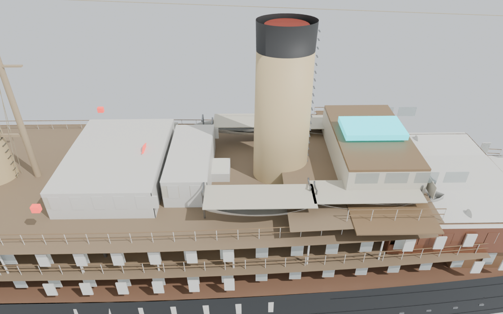
     *Red `NavLights` (`x = 12.5`) float above the aft Boat Deck edge and red `Wheelhouse_Fittings` (`x = 13.9–18.5`) poke through the aft Boat Deck cabin roof on the left, while the cyan-marked `Bridge` (`x = 30.0–43.35`) on the right sits empty.*

2. **[P0] Staterooms Protrude Through Saloon & Promenade Deckhouses + Floating Exterior Windows**
   - **Location:** `blender/build_interiors.py` (`Staterooms`, `Interior_Windows`), `blender/build_superstructure.py` (`DeckHouse_SaloonDeck`, `DeckHouse_Promenade`).
   - **Verified Geometry:**
     - `Staterooms` spans `x_max = 56.82 m, y = ±8.60 m`, protruding **`1.22 m` forward** through `DeckHouse_SaloonDeck` (`x_max = 55.60 m`) onto the open foredeck and **`0.40 m` forward** through `DeckHouse_Promenade` (`x_max = 50.42 m`), producing **16 BVH triangle overlaps** (`Staterooms <-> DeckHouse_Promenade`) and visible open cabin doors sticking out of unenclosed ends.
     - `Interior_Windows` slabs hover completely detached outside the recessed Promenade and Saloon deckhouse walls (`visible in both evidence renders below`).
     - `DeckHouse_Promenade` & `Staterooms` are shaded brown rather than white topsides specified in `shipdesign/spec.py:243` (`upper_white`), and `Decks_SaloonProm` has zero solid thickness.
   - **Visual Evidence:**

     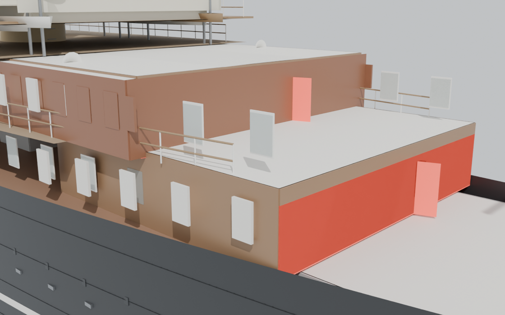
     *Red `Staterooms` with an open cabin door protrude `1.22 m` past the forward end of `DeckHouse_SaloonDeck` onto the open foredeck and clip through the tier above (`16` BVH overlaps), while white `Interior_Windows` rectangles float detached outside the Promenade walls.*

3. **[P1] `Grand_Staircase` Terminates Below Upper Passenger Decks**
   - **Verified Geometry:** `Grand_Staircase` spans `z = [8.80, 15.74] m`, connecting Main Deck (`8.80`) to Promenade (`14.40`), leaving the upper Boat Deck (`17.20`) unconnected.

### 2.2 Propulsion, Hull & Engine-Room Defects

4. **[P0] Propeller Below Keel Baseline & Collision with Rudder / Shaft**
   - **Location:** `blender/build_machinery.py:183-242` (`Propeller`, `Propeller_Shaft`, `Rudder`).
   - **Verified Geometry:**
     - `Propeller` spans `z = [-0.60, +4.70] m`, dipping **`0.60 m` below the keel baseline (`z = 0.0`)** where it would ground in dry dock or shallow water.
     - `Propeller` collides directly with `Rudder` (**`62` intersecting triangle pairs** via BVH check).
     - `Propeller_Shaft` (`x = [-83.0, -21.0] m`, `z = [1.82, 2.28] m`) protrudes **`0.75 m` aft** past `Hull_Shell` (`x_min = -82.26 m`), **pierces cleanly through `Rudder` (`40` intersecting triangle pairs)**, and enters the engine room `0.30 m` too low (`z_center = 2.05 m` vs `Crankshaft z_center = 2.35 m`).
   - **Visual Evidence:**

     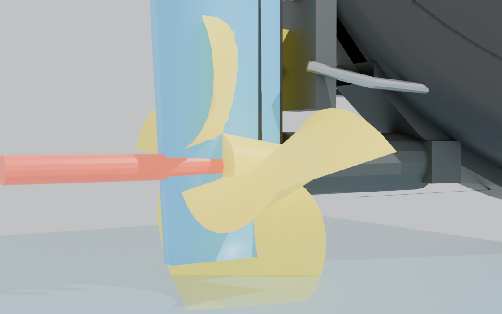
     *Red `Propeller_Shaft` punches through blue `Rudder` (`40` tri pairs) and extends `0.75 m` aft of the stern; yellow `Propeller` slices through `Rudder` (`62` tri pairs) and dips `0.60 m` beneath the translucent `z = 0.0` baseline plane.*

5. **[P0] Engine Room Hull Penetrations, Collapsed LP Rod (`6 cm`), and Immobile Crankshaft**
   - **Location:** `blender/build_machinery.py:165-255`.
   - **Verified Geometry & Root Cause:**
     - `Engine_LP_Rod` measures only **`0.06 m` tall (`z = [3.84, 3.90] m`)** instead of a full piston rod. Root cause at `build_machinery.py:217-225`: both `zc` and `rod_z0` subtract `bore / 2` (`2.565 m` LP cylinder bore), collapsing the rod height to `6 cm`.
     - `Crankshaft` (`40` verts) is a bare smooth cylinder (`z_center = 2.35 m`), misaligned `+0.30 m` above `Propeller_Shaft`, because `Crank_Web`, `Crank_Pin`, `Eccentric`, `Crosshead`, and `ConRod` were all merged static into `Engine_Main`.
     - `Engine_Main` collides with `Hull_Shell` (**`56` BVH tri pairs**, `2` vertices protruding outside the hull); `Boiler_Rooms` protrudes **`0.45 m` through `Hull_Shell`** (`26` vertices outside at `z = 1.3 m`).
   - **Visual Evidence:**

     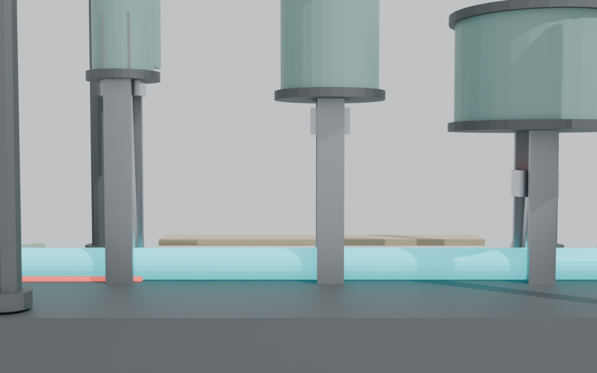
     *View of the triple-expansion engine: red `Propeller_Shaft` sits `0.30 m` below the cyan `Crankshaft` (which lacks crank webs/pins), while `Engine_LP_Rod` (right LP cylinder) is collapsed to a `6 cm` red sliver compared with HP/IP rods.*

6. **[P0] Hull Shell Inverted Normals & Non-Manifold Topology**
   - `Hull_Shell` contains **`516` inward-pointing lateral face normals** (vs `8,612` outward) and **`956` boundary edges**.
   - `Hull_Seams` contains **`28,776` non-manifold edges**.
   - `Boats_Davits` contains **`352` loose vertices** (unconnected geometry).

### 2.3 Silhouette, Historical Accuracy, Drawings & Validation Gaps

7. **[P1] Unraked Funnels (`-0.74°` Forward) & Incomplete Square-Rigged Masts**
   - **Location:** `shipdesign/spec.py:185-203` (`FUNNELS`, `MASTS`).
   - **Verified Geometry:** `FUNNELS` specifies `"rake": 0.0`, producing funnels that sit vertical / tilted **`-0.74°` forward** instead of the period `~5°` aft rake characteristic of 1889 Harland & Wolff / Clyde express liners; `Funnels` also contains **`80` zero-area faces**. Only the **foremast** carries square yards (`y = ±9.5 m`); `mainmast` and `mizzenmast` carry only longitudinal gaffs and booms (inconsistent with a 3-masted barque/schooner-rigged 1889 Atlantic liner).
   - **Visual Evidence:**

     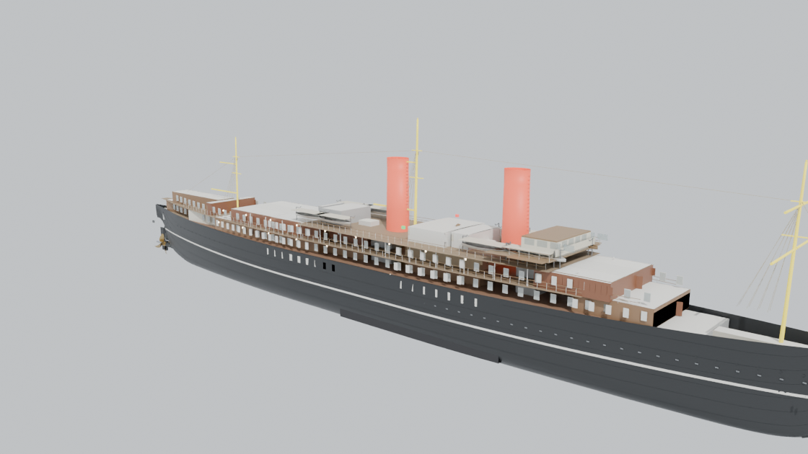
     *3/4 port-bow view: coral-red `Funnels` stand unraked (`-0.74°`), yellow `Masts` show square yards exclusively on the foremast (right), and brown `Staterooms` / floating white `Interior_Windows` slabs are visible along the Promenade/Saloon deckhouses.*

8. **[P1] Historical Anachronisms (`wireless-room` & `hurricane lamps`)**
   - `shipdesign/layout.py:132` allocates `"Chart house & wireless-room store"` — radio/wireless telegraphy at sea (Marconi) did not exist in **1889**.
   - `HISTORICAL_EVIDENCE.md:165` and `Aurelian_DoorsAndLighting.server.lua:17,128` specify `"Hurricane and oil lamps in 1889, not electric pendant lights"`, inverting historical fact: major 1889 North Atlantic express liners (*City of New York*, *City of Paris*, *Teutonic*, *Majestic*, and earlier *Servia* 1881) already used dynamo-powered incandescent electric lighting throughout passenger cabins and saloons.
9. **[P2] Blank `drawings/deck_upper.png`:** Section cut taken at `z = 11.40 m` missed the Upper Deck plane (`z = 11.80 m`), rendering a blank sheet.
10. **[P1] `shipdesign/validate.py` Blind Spots:** Passed (`14 pass, 2 warn, 0 fail`) inside Blender despite all P0 penetrations above because it omits `Y` wall-enclosure checks, `Propeller`/`Rudder`/`Shaft` BVH overlap checks, `Wheelhouse_Fittings`/`NavLights` room checks, normal orientation checks, and skips stair mesh validation.

### 2.4 Ship Roblox Scripts (`ship/roblox/*.lua`)
- **[P0] Fatal Runtime Crash (`math.radians`):** `AurelianShipController.server.lua:153,159,160` calls `math.radians(...)`, which does not exist in Luau (`math.rad` is required), throwing an immediate `attempt to call a nil value` error on heartbeat.
- **[P0] Axis & Welding Mismatch:** `AurelianShipController.server.lua:155,163` steers along `-Z` (`Vector3.new(math.sin(hdg), 0, -math.cos(hdg))`) while exported `Hull.fbx`/`Hull.glb` orient bow along `+X`. Meanwhile, `Aurelian_Assemble.server.lua:151` sets `d.Anchored = true` on every descendant part without welding to `PrimaryPart`, so `root.CFrame = ...` detaches the invisible root from the ship mesh.
- **[P0] Broken Part-Name Contracts:** `Aurelian_Assemble.server.lua:132-133`, `Aurelian_DoorsAndLighting.server.lua:40,122`, `Aurelian_Telegraph.server.lua:99,130`, and `Aurelian_SmokeAndWake.client.lua:30,32` query `Door_*`, `Interior_Lamp*`, `HelmWheel`, `Whistle`, `Funnel_Smoke*`, and `Wake*` — none of which exist in `ship_assembly.blend` or exports (`44` merged meshes only).
- **[P2] Inverted Slider-Crank Ratio:** `Aurelian_EngineAnim.server.lua:89` defines `local throwRatio = 1.0 / 3.4` (`0.294`) while commenting `"connecting rod length / crank r"` (should be `3.4`).

---

## 3. Small Boats (`agent/boats` @ `ec4c3fa`) Audit

### 3.1 25-ft Steam Cutter (`boats/blend/boat_a_steam_cutter.blend`)
**Summary:** `20` mesh objects, `0` UV layers, `0` images, **`58` inter-mesh BVH overlap pairs**.

1. **[P0] Starboard Navigation Sidelight Painted Black (`Hull_Black`) Instead of Green**
   - **Location:** `boats/scripts/build_steam_cutter.py:597` & `boats/scripts/boatgen/bl.py`.
   - **Root Cause:** `bl.py` defines `RedLead` (used on port sidelight) and `Gauge_Glass` (amber/clear), but **no green glass material**. Line `597` falls back to `MAT["paint_hull"]` (`Hull_Black`) + `Gauge_Glass`, rendering the starboard sidelight housing black/amber instead of maritime starboard green.
2. **[P0] Coal Bunker Placed Forward of Boiler, Contradicting Drawings & Note 5**
   - **Location:** `boats/scripts/build_steam_cutter.py` (`X_BUNKER = 1.62 m` vs `X_BOILER = 0.50 m`) vs `boats/scripts/drawings.py` (Note 5) & `boats/drawings/d-002_a.png`.
   - **Verified Geometry:** `X_BUNKER = 1.62 m` places the coal bunker **in the forward passenger cockpit ahead of the boiler** (`x = 0.50 m`), directly contradicting `drawings.py` Note 5 (which specifies the coal bunker *abaft* the boiler for stoking). Furthermore, `d-002_a.png` draws the funnel at `x = 1.10..1.28 m` and boiler half-width at `0.36 m`, disagreeing with the 3D mesh (`Boiler` `x = [0.06, 0.95]`, `y = ±0.406 m`).
3. **[P0] 58 BVH Mesh Collisions, Tilted Shaft (`6.27°`), Ngons & Open Canopy**
   - Key BVH triangle collisions: `Frames <-> Inner_Diagonal_Skin` (**`20,880`**), `Keel_Stem_Frames_Gunwale <-> Planking_Carvel` (**`3,315`**), `Boiler <-> Pipework_Fittings` (`355`), `Boiler <-> Funnel` (`154`), `Keel_Stem_Frames_Gunwale <-> Rudder` (`111`), `Propeller <-> Shafting` (`86`), `Rudder <-> Transom` (`86`).
   - `Shafting` slopes **`6.27°`** (`x = -3.620..-1.116`, `z = -0.300..-0.025`), `Boiler` contains **`474` ngons**, `Canopy_Cover` has **`548` boundary edges** (zero-thickness sheet), aft passenger cockpit lacks floorboards, and `Planking_Carvel` (`23,608`) + `Inner_Diagonal_Skin` (`21,240`) + complete hull (`76,492`) exceed Roblox's 20k limit.
   - **Visual Evidence:**

     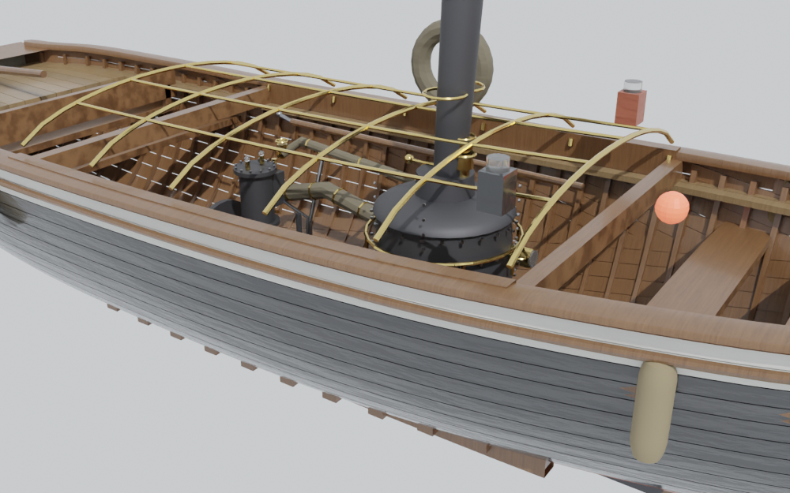
     *With `Canopy_Cover` hidden: the starboard navigation light (foreground) renders dark `Hull_Black`/grey instead of green (versus red port light across), the red sphere marks `X_BUNKER = 1.62 m` sitting inside the forward cockpit ahead of the boiler, and the exposed tilted `Shafting` slopes underneath.*

### 3.2 25-ft Clinker Rowing Cutter (`boats/blend/boat_b_rowing_cutter.blend`)
**Summary:** `24` mesh objects, `0` UV layers, `0` images, **`47` inter-mesh BVH overlap pairs**.

1. **[P0] All 10 `Oar_*` Pivots Placed Inboard Intersecting Thwarts Instead of Rowlocks**
   - **Location:** `boats/scripts/boatgen/parts.py` / `build_rowing_cutter.py` (`Oar_P1..P5`, `Oar_S1..S5`) vs `Rowlocks`.
   - **Verified Geometry:** Every `Oar_*` mesh object has its pivot/origin at its stowed inboard position (**`y = ±0.340..0.765 m`, `z = 0.525..0.609 m`**) instead of the gunwale `Rowlocks` (**`y = ±0.690..0.982 m`, `z = 0.661..0.876 m`**). Because `verify.py` only checks X-station values, it missed the Y/Z offset. Every single oar also collides with `Thwarts_Benches` (e.g., `Oar_P5`: `107` tri pairs, `Oar_S4`: `105`, `Oar_P3`: `77`), and `Oar_S5` penetrates `Thwarts_Benches` (`63`), `Frames` (`60`), and `Planking_Clinker` (`25`).
   - **Visual Evidence:**

     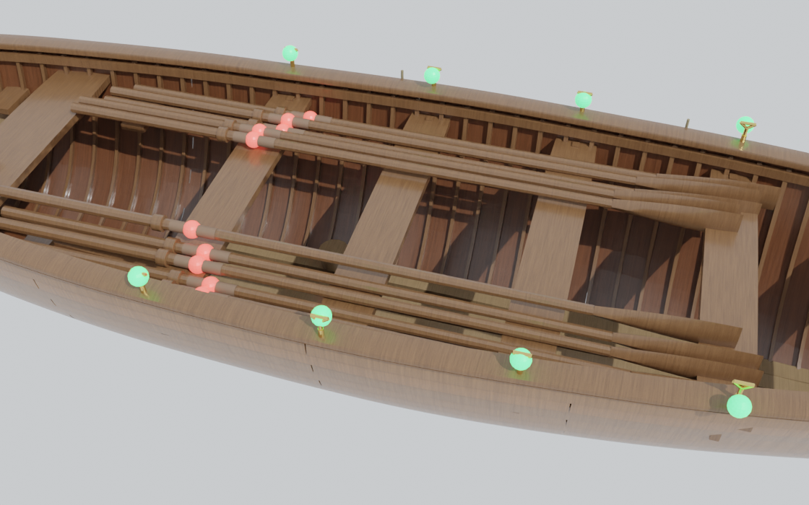
     *Red spheres show the actual `Oar_P1..S5` origins sitting inboard atop and intersecting `Thwarts_Benches`, while green spheres mark the `Rowlocks` along the gunwales where rowing pivots belong.*

2. **[P1] Additional Rowing Cutter Topology & Detail Defects**
   - Key BVH collisions: `Frames <-> Planking_Clinker` (**`14,167`**), `Rudder <-> Keel_Stem_Sternpost` (`68`), `Rudder <-> Transom` (`52`).
   - `Thwart_Knees` consists of **10 plain 8-vertex boxes** (`80` verts / `60` faces total) instead of curved L-knees; `Floorboards` are narrow (`0.732 m`, `y = ±0.366 m`); `Keel_Stem_Sternpost` has **`19` loose edges**; `Planking_Clinker` (`27,896` tris) and combined hull (`48,214` tris) exceed Roblox's 20k limit.

### 3.3 Boats Roblox Scripts & Generator Tooling (`boats/roblox/`)
- **[P0] Fatal Syntax Error in `gen_manifest.py:26`:** Generates `\tparts = {{` (double opening brace) in `Manifest_steam_cutter_1888.lua` and `Manifest_rowing_cutter_25ft.lua`, causing immediate Luau compile failure in `BuildBoat.lua`, `BoatRig.lua`, `SteamCutter.lua`, and `RowingCutter.lua`.
- **[P0] `Hydrodynamics.lua` Buoyancy & Thrust Axis Bugs:**
  - Lines `27-29`: `PROBES` `frac` values are all positive (`0.08..0.86`) instead of spanning `-0.5..+0.5` aft/forward around midships (`origin`), placing all 6 buoyancy probes in the bow half and pitching the stern underwater.
  - Line `92` / thrust direction: `BuildBoat.lua` imports GLBs oriented `+X` forward, whereas `Hydrodynamics.lua` drives along `-Z` (`LookVector`) or applies thrust misaligned with `+X`.
- **[P1] `SteamCutter.lua` Rudder Joint Fighting & Missing Attachment:** Lines `162-169` directly overwrite `self.rudder.CFrame` while `BoatRig.lua:66` binds `Rudder` with a `Motor6D`, reads `RightVector.Y` (roll, not yaw), and compounds CFrame multiplication per frame. Line `69` expects a `FunnelTip` attachment not created by `export_all.py` or `BuildBoat.lua`.

---

## 4. Victorian Ports (`agent/ports` @ `dbcc091`) Audit

### 4.1 Systemic `z = 0` vs. `QUAY_Z = 4.0 m` Grounding Failure

- **Root Cause (`ports/blender/ports/{port_a,port_b}.py`, `lib/{bldg,machinery,maritime}.py`):** `core.py` defines `WATER_Z = 0.0` and `QUAY_Z = 4.0 m`, and ground/cobble paving slabs sit at `z = 4.0 m`. However, nearly all buildings, quayside furniture, bollards, capstans, and streetlamps are generated at local `z = 0` and placed at `loc_z = 0.0` (instead of `loc_z = QUAY_Z`), **burying the bottom `4.0 m` of Port A and Port B underground**.

Verified Z-datum inventory across `port_a.blend` (`548` meshes) and `port_b.blend` (`410` meshes):

| Category | Status vs `QUAY_Z = 4.0 m` | Port A (`Aldermouth`) | Port B (`Carrickmore`) | Impact |
|---|---|---|---|---|
| **Buildings** | Lower `4.0 m` buried (`loc_z = 0`) | `A_terminal` (granite plinth `z=0..0.42`, doors `0.05..2.65`, lit transoms `2.10..2.58` all buried), `A_baggage_hall`, `A_customhouse`, `A_hotel`, `A_station`, `A_terrace`, warehouses | `B_engine_shop`, `B_moulding_loft`, `B_store`, `B_store2`, `B_terrace`, `B_time_office`, `B_sawmill`, `B_smithy` | Ground floors, doorways, plinths, and shop arches disappear underground |
| **100% Buried Furniture** | `z_max <= 1.8 m` (`< 4.0 m`) | `A_bollard` (**83/83**), `A_capstan` (**9/9**), `A_timber` (**5/5**), `A_winch` (**9/13**) | `B_bollard` (**49/49**), `B_capstan` (**10/10**) | Invisible underground; blocks Roblox mooring & quayside navigation |
| **Partially Buried** | `z_min = 0.0 m`, top pokes out | `A_lamp` (**43/43**, `1.26 m` exposed), `A_pole` (**15/15**), `A_fingerpost` (**5/5**, `0.5 m` exposed), `A_coalhoist` (**6/6**) | `B_lamp` (**38/38**), `B_pole` (**9/9**), `B_fingerpost` (**4/4**) | Gas streetlamps resemble knee-high bollards; signposts & coal hoists half-buried |
| **Floating Above Deck** | `z_min >= 4.10 m` | `A_handcart` (`6`, `z_min=4.12`), `A_rails` (`3`, `z_min=4.10`) | `B_cart` (`4`, `z_min=4.12`), `B_rails` (`2`, `z_min=4.10`) | Wheels/rails hover `10–12 cm` above paving |
| **Stranded Prototypes** | Unhidden at world `(0, 0, 0)` | `A_barge.001`, `A_gangway.001` (`build_ports.py`) | — | Prototype meshes collide in central yard/quay |

- **Visual Evidence:**

  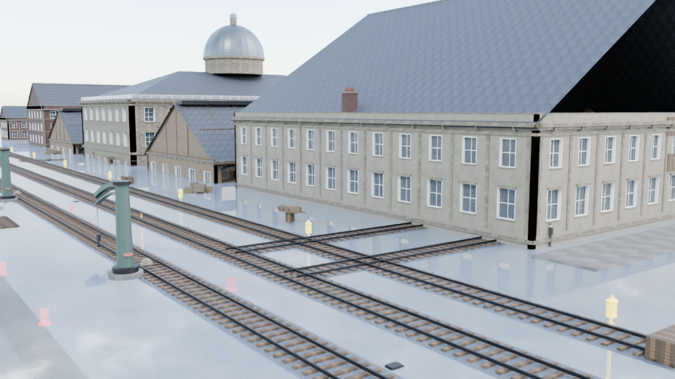
  *With `A_ground` rendered translucent (`z = 4.0 m`), the buried `4.0 m` ground floors (doorways, arches, lit transoms) of `A_terminal`, `A_baggage_hall`, and `A_customhouse`, glowing red buried `A_bollard`s, and knee-high yellow `A_lamp`s are directly exposed.*

### 4.2 Quay-Wall, Railway, Roof & Crane Geometry Bugs

1. **[P0] `_run()` Axis/Sign Bug Misplaces 20 Quay Walls Across Land & Water**
   - **Location:** `ports/blender/ports/port_a.py` (`_run()`), affecting `A_quay24` and `B_quay24`.
   - **Root Cause:** `_run()` drops the `inward` parameter and swaps `(u, fixed)` when `axis == "X"`. As a result, **`20 / 46` `A_quay24` segments** line up along **`y = -30.0 m`** cutting straight across Port A's cobbled yard and jutting `36 m` into the river, while **`25 / 28` `B_quay24` segments** are likewise misplaced.
2. **[P0] Railways Run Directly Over Open Dock & Slipway Water**
   - `A_rail.001` contains **`7,538` faces** running over the open water of Trafalgar Dock (`x = -22 m`, `y = -198..-186 m` and south).
   - `B_rail.001` contains **`2,886` faces** cutting straight across the open river mouths and timber building slips (`Slipways 1–3`, `x = -22 m`, `y = 44.8..56.8 m`) with zero bridges or caissons.
   - **Visual Evidence:**

     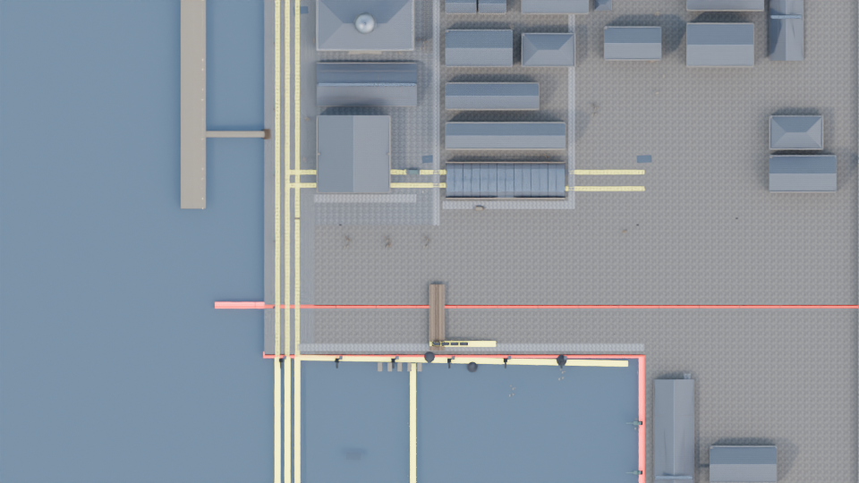
     *Top-down plan of Port A: 20 bright-red `A_quay24` wall segments run east-west across `y = -30 m` slicing through the cobbled quay and projecting into the river, while yellow `A_rail.001` tracks run straight over open Trafalgar Dock water.*

     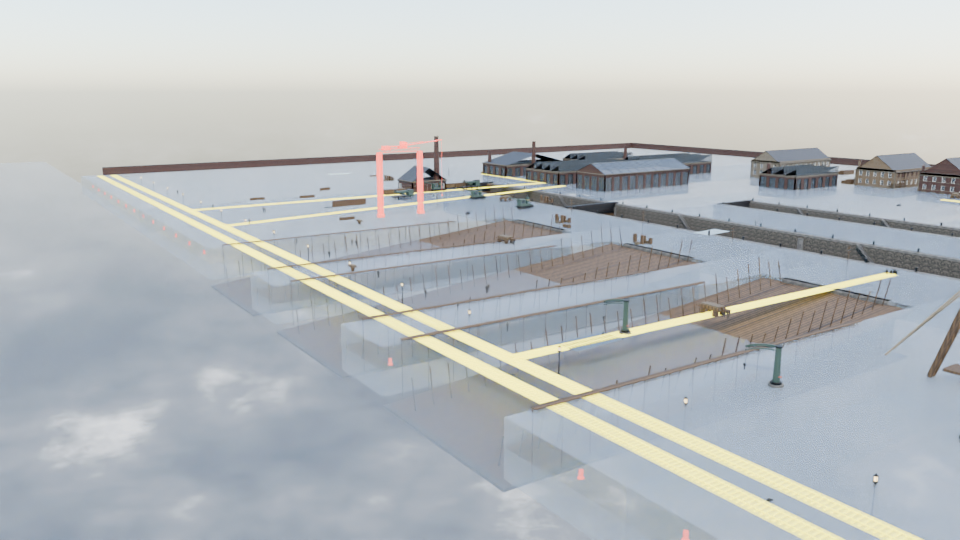
     *Port B oblique cutaway: glowing yellow `B_rail` tracks slice across all three open slipway mouths and timbers, red `B_bollard`s sit buried beneath translucent `B_ground`, and the red `B_titan` crane sits inland.*

3. **[P0] Open See-Through Gable Roofs (`core.py:293-294`) & Sawtooth Placeholder (`bldg.py:657`)**
   - **Root Cause:** In `ports/blender/lib/core.py:293-294` (`add_gable_roof`, `gable == "Y"` branch), only two tiny overhang corner triangles `(ex0..x0)` and `(x1..ex1)` are emitted per end (`4` triangles total), leaving the entire central gable wall missing (`A_terminal`, `A_goods_shed`, `A_dock_shed`, `A_pump_house`, `B_engine_shop`, etc.). Additionally, `ports/blender/lib/bldg.py:657` (`_sawtooth_roof`) emits a zero-area degenerate triangle `((x0, y0, z0), (x0, y0, z0), (x0, y0, z0))`. On `A_terminal`, `port_a.py:477` (`A_signs`) also places painted signboards directly across the 2nd-floor windows.
   - **Visual Evidence:**

     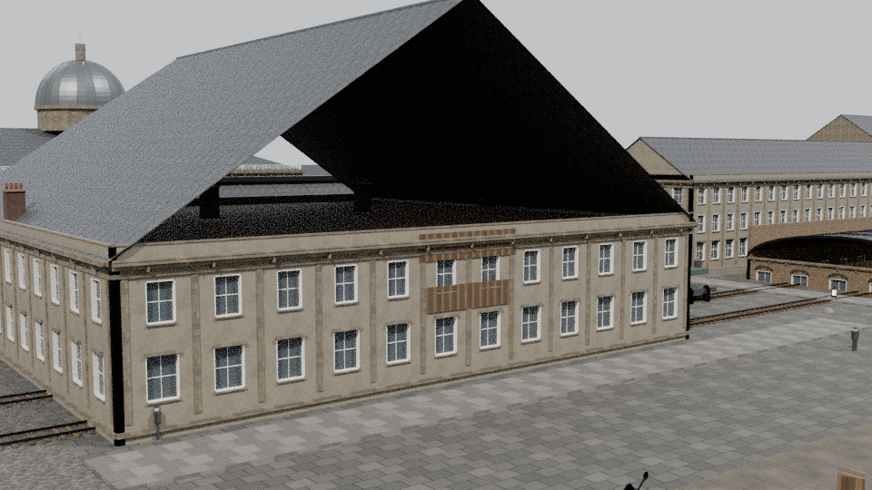
     *`A_terminal` shows the hollow roof cavity seeing straight through to the opposite side due to `core.py:293-294` omitting gable triangles, alongside a signboard overlapping 2nd-floor windows, black corner quoins, and a knee-high buried `A_lamp` at bottom-left.*

4. **[P1] `B_titan.001` Historical & Placement Error**
   - `ports/HISTORICAL_EVIDENCE.md:7` sets an explicit **1889 cutoff** (`excluding 1902–11 Thompson Dock and 1905–08 Arrol Gantry`), yet `machinery.py:104-152` models `B_titan` as a **24.7 m-tall travelling portal giant-cantilever crane** (an Edwardian 1904–1914 shipyard crane class, e.g., Clydebank 1907 / Fairfield 1911 / Harland & Wolff 1909–11; 1889 fitting-out berths used iron sheer legs).
   - In the 3D scene (`port_b.py:231`), `B_titan.001` is placed at `(40.0, 200.0, 4.0)` with `rot = 0°` — its **bogie wheels sit on bare ground with zero crane rails**, and its **`16 m` cantilever jib points EAST (`x = [31.55, 56.17]`)**, `61.5 m` inland away from the fitting-out quay wall (`x = -30.0 m`).
5. **[P1] Unwelded `MeshBuilder` Bloat & Flat Port A Hierarchy:** Every `MeshBuilder.add_box()`/`add_beam()` creates unmerged vertices (`~2–3.7×` excessive vertex/triangle count), blowing `port_a_full.fbx` to `796,308` tris (`37.9 MB` GLB) and `port_b_full.fbx` to `384,958` tris (`24.3 MB` GLB). `port_a.blend` also drops all meshes into a single flat collection rather than organizing prototypes vs instances.

### 4.3 Ports Roblox Scripts (`ports/roblox/src/*.luau`)
- **[P0] 12 of 22 Interaction Anchors Have No Handler (`PortServer.server.luau`):** Only `9` active anchor `kind` values (`10` anchors) match `handlers` (`ticket_purchase`, `customs`, `mooring`, `worker_gate`, `dock_floor_work`, `loft_work`, `workshop`, `slip_work`, `crane_operate`), while `gangway` and `cargo` are unused dead keys. The remaining **`12` anchors across `10` distinct kinds** (`baggage_checkin`, `board_via_bridge` ×2, `spawn_passenger`, `board_ship`, `coal_bunkering`, `cargo_work`, `train_board`, `dock_caisson`, `materials` ×2, `fitting_out`) fall through to `notify(player, "Nothing to do there.")`.
- **[P0] Broken Client Notice Channel & Server State Access (`PortClient.client.luau`):** Lines `23-25` instantiate a private client-only `RemoteEvent` inside `playerGui` instead of listening to `ReplicatedStorage.PortNotice`, and line `17` requires server-only `ShipService` from a `LocalScript` (returns empty client table).
- **[P0] Mooring Rope & Gangway Math Bugs (`Mooring.luau`):**
  - Line `53`: `rope.Length = (a.Position - b.Position).Magnitude / Config.STUDS_PER_METRE` converts stud distance to metres (`3.57×` too short), snapping ships violently into quay walls.
  - Lines `90, 96`: `Size = Vector3.new(length, deckThickness, widthStuds)` orient length along X instead of Z (`CFrame.lookAt` forward), and `CFrame.Angles(0, 0, math.atan2(rise, length))` rolls the gangway sideways instead of pitching (`X` axis).
  - Line `120`: `cleatAt(shipPart, Vector3.new(0, 0, 0))` ignores `spec.shipFraction` / `lineOffsetStuds`.
- **[P1] Misplaced Roblox Anchors (`PortLayoutB.luau`):** `B-I3` (Princess Dock Floor) is placed at **`z = -11.0 m`** — **`4.0 m` below** the stone dock floor (`z = -7.0 m`, outer bbox `z_min = -7.6 m`); `B-I10` (Fitting-out Quay) sits at `x = -34.0 m` **over open river water** west of the quay wall (`x = -30.0 m`).

---

## 5. Prioritized Remediation Roadmap

### Phase 1 — P0 Blockers (Contracts, Placement & Runtime Crashes)
1. **Unify Interface & Export Standard (`agent/ship`, `agent/boats`, `agent/ports`):**
   - Lock a single canonical `boats_spec.json` (resolve `1450/880 kg` vs `4200/650 kg`, coal vs oil firing, dipping lug rig, craft IDs, and davit stowage metadata).
   - Standardize all FBX/GLB exports on **1 unit = 1 metre, `+Y` up, `-Z` forward** (or document and enforce a single conversion in Roblox assembly scripts), fix `boats/scripts/export_all.py:76` (`calc_loop_triangles()` before reading `len(ob.data.loop_triangles)`), and remove redundant embedded texture copies from modular Ports GLBs.
2. **Fix Ocean Liner Superstructure & Machinery (`agent/ship`):**
   - Move `Wheelhouse_Fittings` and `NavLights` (`build_superstructure.py:835`) into `Bridge` (`x = 30.00..43.35`) and bridge wings; trim `Staterooms` & reposition `Interior_Windows` cleanly inside `DeckHouse_SaloonDeck` / `DeckHouse_Promenade`.
   - Fix `Propeller` vertical position (`z_min >= 0.30 m` above keel baseline), terminate `Propeller_Shaft` cleanly at the sternpost ahead of `Rudder` (`x > -79.5 m`), align shaft elevation (`z = 2.35 m`) with `Crankshaft`, fix `Engine_LP_Rod` `bore/2` double-subtraction (`build_machinery.py:217-225`), separate crank webs/pins/connecting rods for animation, and resolve `Engine_Main` / `Boiler_Rooms` hull protrusions.
   - Recalculate outward normals on `Hull_Shell`, close boundary edges, and decimate/split `Third_Class` (`73.2k`), `Dining_Saloon_1C` (`58.8k`), and `Hull_Seams` (`24.0k`) under 20k triangles with UV unwraps.
3. **Fix Small Boats Geometry & Roblox Scripts (`agent/boats`):**
   - Add a `GreenGlass` material to `bl.py` and assign it to the starboard sidelight in `build_steam_cutter.py:597`; relocate `X_BUNKER` abaft the boiler (`x < 0.0`) and reconcile `drawings.py` / `d-002_a.png`.
   - Re-origin all 10 `Oar_*` pivots onto `Rowlocks` (`y ≈ ±0.85 m, z ≈ 0.77 m`) and adjust stowed offsets to eliminate thwart/hull intersections; decimate meshes >20k tris and add UV maps.
   - Fix `gen_manifest.py:26` (`parts = {`), symmetric aft/forward `PROBES` in `Hydrodynamics.lua`, forward axis alignment, and `Motor6D` rudder control in `SteamCutter.lua`.
4. **Fix Ports Z-Datum, Quay Walls, Rails, Gables & Roblox Handlers (`agent/ports`):**
   - Lift all street-level buildings, bollards, capstans, streetlamps, timber stacks, winches, and fingerposts to `loc_z = QUAY_Z` (`4.0 m`), remove stray `(0, 0, 0)` prototype duplicates (`build_ports.py`), and drop `handcart`/`rails` flush onto `z = 4.0 m`.
   - Fix `_run()` in `port_a.py` (`inward` & `(u, fixed)` swap for `axis == "X"`) and re-route `A_rail.001` / `B_rail.001` onto solid quays/bridges clear of water and slips.
   - Fix `core.py:293-294` full gable triangles when `gable == "Y"`, fix `bldg.py:657` `_sawtooth_roof` gable faces, and clear `A_signs` from `A_terminal` windows.
   - Implement all 10 missing `PortServer.server.luau` handlers (or unify names with `PortLayoutA`/`PortLayoutB`), connect `PortClient.client.luau` to `ReplicatedStorage.PortNotice` via a `RemoteFunction`/attributes instead of reading server `ShipService`, and fix `Mooring.luau` rope length (`no / 3.57`), gangway pitch (`X` axis, `Z`-length), and `lineOffsetStuds`.

### Phase 2 — P1 High Priority (Silhouette, Historical Accuracy, QA Gates & Decimation)
1. Weld coincident vertices in `ports/blender/lib/core.py` (`MeshBuilder`) and decimate all 11 >20k-tri Port prototypes + 5 Boats parts + 3 Ship parts; generate clean UVs on Ship & Boats.
2. Set `FUNNELS` rake to `~5°` aft in `shipdesign/spec.py:185`, add square yards/topmasts consistently or align rig documentation, extend `Grand_Staircase` to Boat Deck (`z = 17.2 m`), replace anachronistic `"wireless-room"` (`layout.py:132`) and oil/hurricane lamp specs (`HISTORICAL_EVIDENCE.md:165`) with 1889 dynamo/incandescent lighting.
3. Replace or rotate/re-rail `B_titan.001` (use historical 1889 tubular sheer legs or align crane on rails facing `-X` over `B-B1`), fix `B-I3` (`z = -7.0 m`) and `B-I10` (`x = -30.0 m`), and expand `A-B2/B3/B4` & `B-B3` (plus add Princess Dock to `Layout.berths`) to meet `BERTH_CLEARANCE_M = 4.0` for *SS Aurelian*.
4. Upgrade `shipdesign/validate.py`, `boats/scripts/verify.py`, and Ports QA scripts to assert: zero inter-mesh BVH penetrations, `z >= QUAY_Z` deck grounding, `<= 20,000` triangles per export mesh, outward face normals, UV presence, Luau syntax compilation (`luau-analyze`), and `PortServer` handler completeness.

### Phase 3 — P2/P3 Polish
1. Replace boxy 8-vertex `Thwart_Knees` in `boat_b_rowing_cutter.blend`, remove `Hull_Seams` non-manifold edges & `Boats_Davits` loose vertices, fix `drawings/deck_upper.png` slice height (`11.80 m`), fix `Aurelian_EngineAnim.server.lua` `throwRatio = 3.4`, and organize `port_a.blend` collections cleanly.
