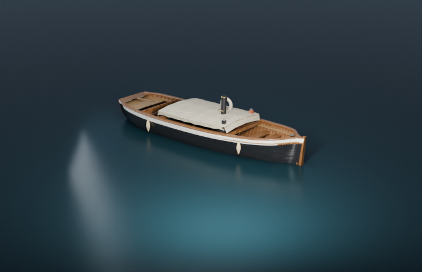

# OPERATION VICTORIA — the ship's boats

Two small craft for the 1889 British ocean liner *Victoria*, built from first
principles as complete, operable vessels and delivered as Blender models,
Roblox models and scripts, drawings and documentation.

| | **Boat A** | **Boat B** |
|---|---|---|
| Type | 25 ft steam cutter / steam tender | 25 ft clinker rowing cutter, 10-oared |
| Length overall | 7.620 m (25 ft 0 in) | 7.620 m (25 ft 0 in) |
| Beam | 2.134 m (7 ft 0 in) | 1.905 m (6 ft 3 in) |
| Draught loaded | 0.527 m | 0.397 m |
| Displacement loaded | 3532 kg | 1897 kg |
| Construction | carvel over double-diagonal, 12 frames | clinker, 11 strakes, oak frames |
| Machinery | 5½ × 6 in inverted vertical engine, coal-fired vertical boiler, 2-bladed screw | 10 oars, steering by bank imbalance |
| Blender file | `blend/boat_a_steam_cutter.blend` | `blend/boat_b_rowing_cutter.blend` |
| Objects / faces | 20 / 39 865 | 24 / 28 826 |




The boats are rendered afloat on a sea surface placed at **z = 0**, which is
the load waterline by the authoring convention — so the renders double as a
check that the published draught and the modelled hull agree.

---

## Where everything is

```
boats/
├── blend/                finished .blend files (bpy 4.2 LTS)
├── exports/              per-part GLB + FBX + manifest.json for Roblox
├── renders/              the published render set: both boats afloat at their
│                         designed waterline, plus cutaways
├── drawings/             dimensioned technical drawings (PNG + SVG) and the
│                         historical reference board
├── scripts/
│   ├── boatgen/          the geometry library (see below)
│   ├── build_steam_cutter.py
│   ├── build_rowing_cutter.py
│   ├── render_sheet.py   the published render set
│   ├── render_cutaway.py sectioned renders
│   ├── export_all.py     GLB/FBX + manifest
│   ├── drawings.py       technical drawings
│   ├── publish_spec.py   -> interfaces/boats_spec.json
│   └── verify.py         automated geometric QA
├── docs/
│   ├── CONSTRUCTION_A_steam_cutter.md
│   ├── CONSTRUCTION_B_rowing_cutter.md
│   ├── TESTING.md
│   └── VERIFICATION.md   (generated: 23 checks, 0 failures)
├── HISTORICAL_EVIDENCE.md
└── refs/rmg/             the reference photographs
```

Roblox work is in `/roblox`; the interface the ship agent needs is
`/interfaces/boats_spec.json` (human summary: `/interfaces/BOATS_INTERFACE.md`).

## The geometry library

Nothing in this project is a downloaded or borrowed model. The hulls are
generated from designed curves and then built up plank by plank:

| module | what it does |
|---|---|
| `boatgen/geom.py` | numpy kernel — PCHIP curves, a mesh builder with grids, lathes, tubes, prisms, bolts |
| `boatgen/hull.py` | `HullDesign` (surface / normal / inner / keel and sheer paths / hydrostatics) and the builders: clinker planking, carvel planking, double-diagonal skin, frames, keel, stem, sternpost, transom, gunwale, keelson |
| `boatgen/machinery.py` | the steam plant: riveted boiler with internals, inverted vertical engine with Stephenson link, shafting, stern tube, pitched-blade screw, funnel, pipework, valves, gauges, whistle |
| `boatgen/parts.py` | boat's gear: oars, rowlocks, thwarts, knees, floor gratings, rudder, eye bolts, fenders |
| `boatgen/hydro.py` | displacement and trim integration |
| `boatgen/specs.py` | the numbers — dimensions, weights, and the published interface spec |
| `boatgen/bl.py` | Blender scene, materials, studio lighting, cameras, export |

## Rebuilding

Requires Blender 4.2 LTS (installed at `/var/tmp/blender`).

```bash
cd boats/scripts
export LD_LIBRARY_PATH=/var/tmp/blender/lib
B=/var/tmp/blender/blender

$B -b --python build_steam_cutter.py -- --quick   # or omit --quick for full renders
$B -b --python build_rowing_cutter.py -- --quick

$B -b --python verify.py -- both        # 23 geometric checks
$B -b --python export_all.py -- both    # GLB/FBX + manifest
$B -b --python render_sheet.py -- both  # published renders
$B -b --python render_cutaway.py -- both

python3 publish_spec.py                 # interfaces/boats_spec.json
python3 drawings.py                     # the drawing sheets
```

Everything is deterministic: dimensions come from `specs.py`, hull form from
`hull.py`, and the drawings are generated from the same `HullDesign` objects
as the meshes — so the drawing and the model cannot drift apart.

## Scale and orientation

* Authored in **metres**, **Z up**, **+X forward (stem)**, **+Y to port**.
* **Z = 0 is the load waterline**, solved by the hydrostatic integration.
* Origin on the centreline at mid-LOA.
* **1 stud = 0.28 m** (1 m = 3.5714 studs); 25 ft = 27.21 studs.
* GLB export is Y-up; `BuildBoat` rotates the model 90° about Y so the bow
  points −Z (Roblox forward) and applies the stud scale.

## What is documented and what is reconstructed

Read `HISTORICAL_EVIDENCE.md` before quoting anything here as fact. In
short: the principal dimensions and structural *types* are documented
(1888 Admiralty steam cutter proposal, RMG clinker cutter models, Service
establishment tables); the hull lines of both boats and every machinery
dimension are **reconstructed** to those dimensions and are labelled as such.

## Status

* Geometry, drawings, documentation, interface spec — **complete and verified**
  (23 automated checks, 0 failures: `docs/VERIFICATION.md`).
* Roblox scripts — **complete and compiling**, but **not yet run in Studio**;
  the acceptance test list to close that out is in `docs/TESTING.md` §2.

## Known limitations

Recorded here rather than glossed over:

1. **No traceable drawing for Boat A's hull.** The 1888 plan has no public
   image, so the lines are a reconstruction to the published dimensions. This
   is stated in the drawings, the evidence file and the render captions.
2. **Gunwale detail.** The gunwale is a plain bar of correct section; a cap
   rail with a moulded edge would be better and is the obvious next
   improvement on Boat B, where the reference model shows a distinct capping
   strip.
3. **Engine authority.** The steam engine is sized by reasoning from period
   practice (5½ × 6 in, ~5 ihp), not from a surviving drawing of this exact
   unit. It is mechanically complete — piston, crosshead, guides, con-rod,
   crank, valve gear, reversing link — but it is a reconstruction.
4. **Roblox thrust values** are first estimates in Roblox force units and
   will need one tuning pass against the in-engine hull masses.
5. **Cutting tools and loose gear** are modelled where they affect how the
   boat works (shovel, bucket, boat hook). The boats are not populated with
   every item a real boat's inventory lists.
