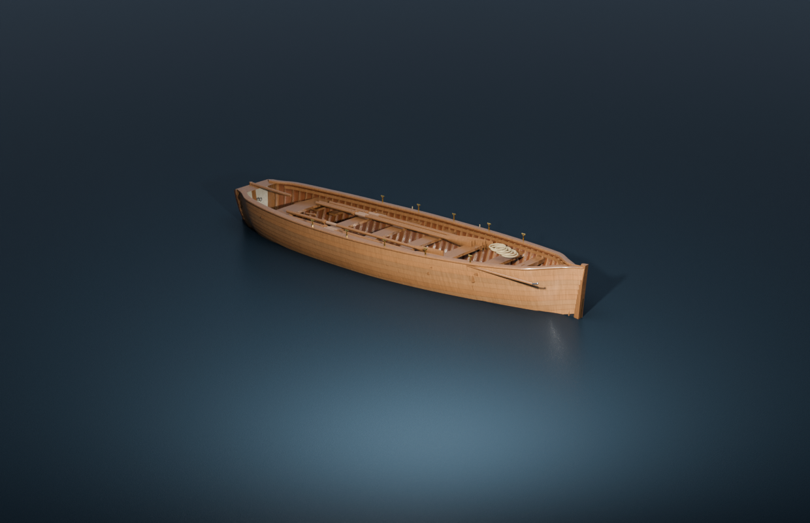
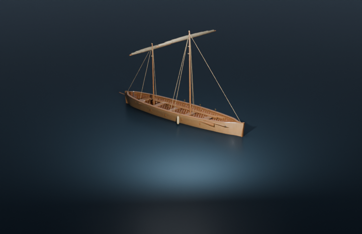

# OPERATION VICTORIA — the ship's boats

Three small craft for the 1889 British ocean liner *Victoria*, built from first
principles as complete, operable vessels and delivered as Blender models,
Roblox models and scripts, drawings and documentation.

They are deliberately three different answers to the same question. A steamer,
a pulling cutter and a double-ended sea boat: one with machinery, one with ten
oars and a transom, and one with two masts and no transom at all.

| | **Boat A** | **Boat B** | **Boat C** |
|---|---|---|---|
| Type | 25 ft steam cutter / steam tender | 25 ft clinker rowing cutter, 10-oared | 27 ft double-ended whaler |
| Length overall | 7.620 m (25 ft 0 in) | 7.620 m (25 ft 0 in) | 8.230 m (27 ft 0 in) |
| Beam | 2.134 m (7 ft 0 in) | 1.905 m (6 ft 3 in) | 1.829 m (6 ft 0 in) |
| Draught loaded | 0.527 m | 0.397 m | 0.436 m |
| Displacement loaded | 3532 kg | 1897 kg | 1487 kg |
| Ends | transom | transom | **double ended — no transom** |
| Construction | carvel over double-diagonal, 12 frames | clinker, 11 strakes, oak frames | clinker, 9 strakes, 68 frames, drop keel |
| Propulsion | 5½ × 6 in inverted vertical engine, coal-fired boiler, 2-bladed screw | 10 oars, double banked | 5 oars single banked + standing-lug yawl rig |
| Blender file | `blend/boat_a_steam_cutter.blend` | `blend/boat_b_rowing_cutter.blend` | `blend/boat_c_whaler.blend` |
| Objects / faces | 20 / 45 420 | 24 / 29 948 | 18 / 28 949 |





The boats are rendered afloat on a sea surface placed at **z = 0**, which is
the load waterline by the authoring convention — so the renders double as a
check that the published draught and the modelled hull agree.

---

## Where everything is

```
boats/
├── blend/                finished .blend files (bpy 4.2 LTS)
├── exports/              per-part GLB + FBX + manifest.json for Roblox
├── renders/              the published render set: both boats afloat at their
│                         designed waterline, plus cutaways
├── drawings/             dimensioned technical drawings (PNG + SVG) and the
│                         historical reference board
├── scripts/
│   ├── boatgen/          the geometry library (see below)
│   ├── build_steam_cutter.py
│   ├── build_rowing_cutter.py
│   ├── build_whaler.py
│   ├── render_sheet.py   the published render set
│   ├── render_cutaway.py sectioned renders
│   ├── export_all.py     GLB/FBX + manifest
│   ├── drawings.py       technical drawings
│   ├── publish_spec.py   -> interfaces/boats_spec.json
│   └── verify.py         automated geometric QA
├── docs/
│   ├── CONSTRUCTION_A_steam_cutter.md
│   ├── CONSTRUCTION_B_rowing_cutter.md
│   ├── CONSTRUCTION_C_whaler.md
│   ├── TESTING.md
│   ├── REALISM_PASS.md   how the models and renders were pushed to look right
│   └── VERIFICATION.md   (generated)
├── HISTORICAL_EVIDENCE.md
└── refs/rmg/             the reference photographs
```

Roblox work is in `/roblox`; the interface the ship agent needs is
`/interfaces/boats_spec.json` (human summary: `/interfaces/BOATS_INTERFACE.md`).

## The geometry library

Nothing in this project is a downloaded or borrowed model. The hulls are
generated from designed curves and then built up plank by plank:

| module | what it does |
|---|---|
| `boatgen/geom.py` | numpy kernel — PCHIP curves, a mesh builder with grids, lathes, tubes, prisms, bolts |
| `boatgen/hull.py` | `HullDesign` (surface / normal / inner / keel and sheer paths / hydrostatics) and the builders: clinker planking, carvel planking, double-diagonal skin, frames, keel, stem, sternpost, transom, gunwale, keelson |
| `boatgen/machinery.py` | the steam plant: riveted boiler with internals, inverted vertical engine with Stephenson link, shafting, stern tube, pitched-blade screw, funnel, pipework, valves, gauges, whistle |
| `boatgen/parts.py` | boat's gear: oars, rowlocks, thwarts, knees, floor gratings, rudder, eye bolts, fenders |
| `boatgen/hydro.py` | displacement and trim integration |
| `boatgen/specs.py` | the numbers — dimensions, weights, and the published interface spec |
| `boatgen/bl.py` | Blender scene, materials, studio lighting, cameras, export |


### Rendering

The renders are produced by `render_sheet.py` and `render_cutaway.py`, which
drop any cameras and lights out of the saved `.blend`, build a fresh rig, and
frame each view from the evaluated geometry rather than from hand-placed
cameras.

The rig is deliberately neutral: an **overcast sky** (`world_strength` ≈ 2.6)
plus one small high sun and a soft overhead key, with a plain sea plane at
**z = 0** — the load waterline. Two consequences worth knowing:

* the renders are also a **displacement check** — if the hydrostatics and the
  modelled hull disagreed, the boat would float visibly too high or too low;
* there are **no near-horizon lamps**. At the grazing angles a camera sees open
  water from, a lamp near the horizon reflects almost totally (Fresnel) and
  paints a bright parallelogram across the sea that reads as a light leak.
  Lamps are also `visible_camera = False` so none of them can appear in frame.

The full story of how the render environment was arrived at — including the
three failed attempts at the water — is in
[`docs/REALISM_PASS.md`](docs/REALISM_PASS.md).

Water is a flat plane with a stretched noise bump and low specular — enough to
read as slow harbour water at 1240 × 800, not a wave model.

## Rebuilding

Requires Blender 4.2 LTS (installed at `/var/tmp/blender` — `scripts/setup_blender.sh`
fetches it; do not unpack it inside the repo, it is 1.3 GB) and `matplotlib`
for the drawing sheets (`pip install matplotlib`).

```bash
cd boats/scripts
export LD_LIBRARY_PATH=/var/tmp/blender/lib
B=/var/tmp/blender/blender

$B -b --python build_steam_cutter.py -- --quick   # or omit --quick for full renders
$B -b --python build_rowing_cutter.py -- --quick

$B -b --python verify.py -- both        # 23 geometric checks
$B -b --python export_all.py -- both    # GLB/FBX + manifest
$B -b --python render_sheet.py -- both  # published renders
$B -b --python render_cutaway.py -- both

python3 publish_spec.py                 # interfaces/boats_spec.json
python3 drawings.py                     # the drawing sheets
```

Everything is deterministic: dimensions come from `specs.py`, hull form from
`hull.py`, and the drawings are generated from the same `HullDesign` objects
as the meshes — so the drawing and the model cannot drift apart.

## Scale and orientation

* Authored in **metres**, **Z up**, **+X forward (stem)**, **+Y to port**.
* **Z = 0 is the load waterline**, solved by the hydrostatic integration.
* Origin on the centreline at mid-LOA.
* **1 stud = 0.28 m** (1 m = 3.5714 studs); 25 ft = 27.21 studs.
* GLB export is Y-up; `BuildBoat` rotates the model 90° about Y so the bow
  points −Z (Roblox forward) and applies the stud scale.

## What is documented and what is reconstructed

Read `HISTORICAL_EVIDENCE.md` before quoting anything here as fact. In
short: the principal dimensions and structural *types* are documented
(1888 Admiralty steam cutter proposal, RMG clinker cutter models, Service
establishment tables); the hull lines of both boats and every machinery
dimension are **reconstructed** to those dimensions and are labelled as such.

## Status

* Geometry, drawings, documentation, interface spec — **complete and verified**
  (30 automated checks over the three boats, 0 failures: `docs/VERIFICATION.md`).
* All 13 Luau modules and all three generated manifests compile.
* Roblox scripts — **complete and compiling**, but **not yet run in Studio**;
  the acceptance test list to close that out is in `docs/TESTING.md` §2.

## Known limitations

Recorded here rather than glossed over:

1. **No traceable drawing for Boat A's hull, or for Boat C's.** The 1888 steam
   cutter plan has no public image, so its lines are a reconstruction to the
   published dimensions; the whaler is likewise a reconstruction of a *type* —
   its length, beam, draught and weight are documented, its lines are not.
   Both are stated in the drawings, the evidence file and the render captions.
2. **Gunwale and fittings are modelled, not joinery.** Both boats now carry a
   moulded cap rail, a half-round rubbing strake and a metal stem band, but
   the joints between them (scarphs, fastenings, the way the cap is let down
   over the frame heads) are not modelled. At 1240 × 800 they read correctly;
   at arm's length they would not.
3. **Engine authority.** The steam engine is sized by reasoning from period
   practice (5½ × 6 in, ~5 ihp), not from a surviving drawing of this exact
   unit. It is mechanically complete — piston, crosshead, guides, con-rod,
   crank, valve gear, reversing link — but it is a reconstruction.
4. **Roblox thrust values** are first estimates in Roblox force units and
   will need one tuning pass against the in-engine hull masses.
5. **The sea is a plane.** Water is a single flat surface at the load
   waterline with a bump pattern; there is no wave model, no spray and no
   wake. The render is a portrait of the boat, not a sea state.
6. **Cutting tools and loose gear** are modelled where they affect how the
   boat works (shovel, bucket, boat hook). The boats are not populated with
   every item a real boat's inventory lists.
7. **Boat C's sails are stowed, not set.** The canvas is modelled furled and
   stopped along the yards, which is the condition of a boat in the davits.
   There is no set sail to look at. The spars, hoops, gaskets, shrouds, stays
   and halyards are all modelled, so setting the canvas would mean adding one
   surface per sail, not rebuilding the rig.
