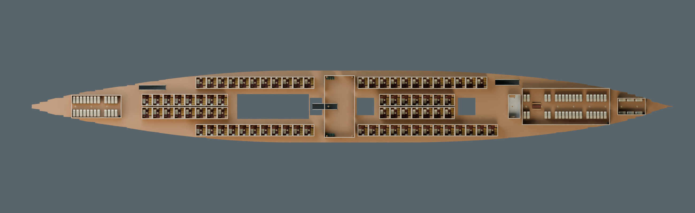
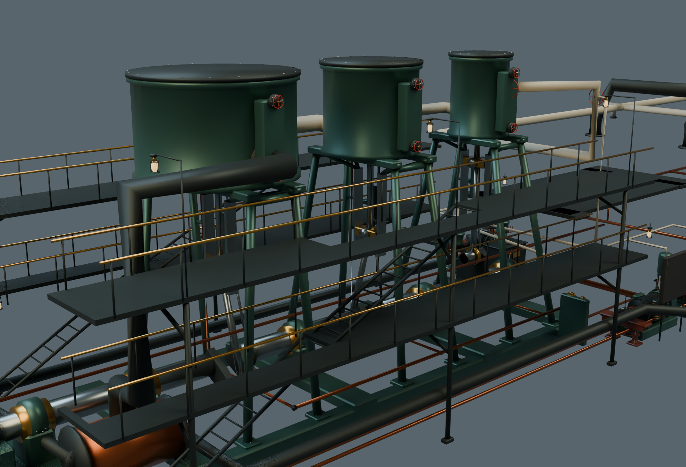
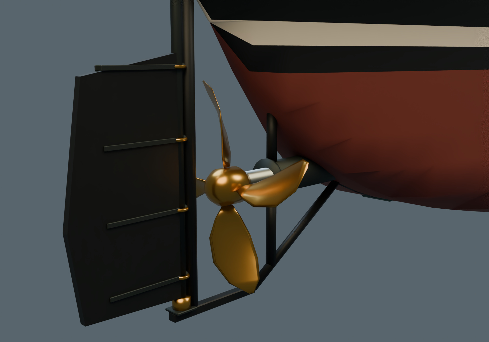
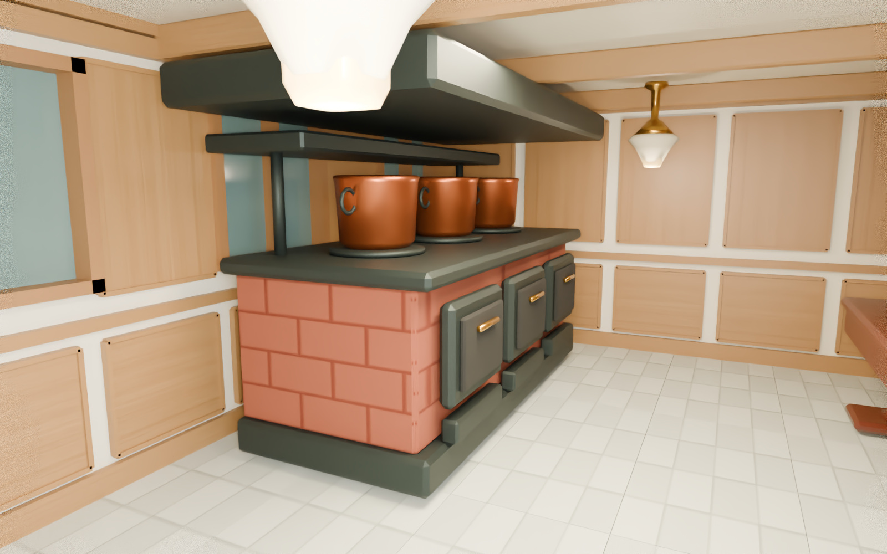
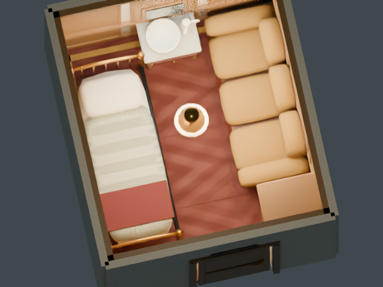
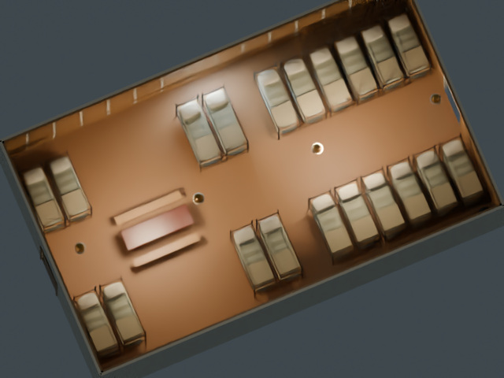

# SS Aurelian / LEONIDAS-II — detailed progress report

**Interim publication, not a completed playable release.** This snapshot was prepared at the user's request for an immediate report with renders. Work is continuing on the same `agent/leonidas-ii` branch. All figures below describe this snapshot, not an assertion that the entire original brief has been accepted.

## At a glance

| Workstream | Completed at this snapshot | Still outstanding |
|---|---:|---|
| Editable ship, regional export and import kit | Build 12 produced and headlessly checked | Roblox Studio import and appearance acceptance |
| Physical-space survey images | **203 / 203 reviewed** | No missing survey; hidden surfaces and live use remain unverified |
| Major interior/exterior/engineering/deck images | **22 / 51 reviewed** | **29 major views** need final processing/review |
| All planned model images | **225 / 254 reviewed (88.6%)** | 29 images; this is image coverage, **not overall project completion** |
| Editable analytical drawings | **3 / 3 SVGs opened**; vector PDFs supplied | Not certified construction or historical tracing documents |
| Exact Luau source compilation | **6 / 6 pass** | Roblox API/type/engine acceptance |
| Runtime logic/transform mock tests | **30 pass** | Actual physics, passengers, replication and device performance |
| Current delivery checker | **42 PASS / 4 UNVERIFIED / 0 FAIL** | Complete evidence, complete major review, three revision-image checks, Studio/live acceptance |

Six of the 29 outstanding major views already have completed raw frames. They are **not** counted as delivered/reviewed JPGs until processing and inspection finish. Raw scratch and rejected older-generation renders are not included as current evidence.

**There is no defensible single overall “percent done.”** The reconstruction and headless export pipeline are built, but image review is incomplete and the essential Studio/live gates cannot be completed in this headless workspace.

## 1. What has been built

### Ship and editable source

The project remains the fictional **SS Aurelian, 1889**, a British Atlantic express passenger/mail-and-cargo liner on the Liverpool–Queenstown–New York route. It retains the **166.00 m LOA / 158.00 m LBP / 18.40 m moulded beam / 6.50 m design draught**, single screw, nine boilers, two funnels and three pole masts. It has not been substituted with a launch, yacht or literal replica of another liner.

The inherited model was inspected before reconstruction. Useful identity, dimensional and interface intent were retained; the shell/counter stern, framing, decks, bulkheads, room layout, furnishings, machinery, materials, export and runtime implementation were substantially rebuilt. Original assets remain in Git as provenance and are not the intended installation path.

| Current measured item | Result |
|---|---:|
| Editable master mesh objects / triangles | 1,422 / 3,300,554 |
| Individually inventoried physical spaces | 203 |
| GAME visual nodes / unique meshes / reused placements | 1,438 / 860 / 578 |
| GAME placed triangles | 2,473,152 |
| Maximum triangles in one exported visual node | 18,000 |
| Complementary regional GLBs | 18 |
| Native collision proxies / compartment doors | 4,071 / 196 |
| Named moving assemblies | 20 |
| Modeled native seats | 219, including four crew-mess positions; plus helm VehicleSeat |
| Light positions / main stairs / engine ladders | 346 / 13 / 4 |

The editable `.blend` has semantic organization and packed original maps. Six original 2048-square source maps, atlas/sign resources, an explicit room inventory and the dimensional/interface manifests are supplied. Rendering temporarily uses a smaller texture cache; the delivered original maps are unchanged.

### Interiors and working spaces

The 203-space inventory includes 114 first-class cabins, 33 second-class cabins, captain/officer accommodation, five third-class and five crew dormitories, public rooms, sanitary/service/storage rooms and seven machinery spaces. Repeated cabin types are real separately bounded/furnished spaces, **not 203 unique furniture designs**.

Modeled public/service spaces include dining, library/writing, smoking, music and second-class lounges, stair halls, wheelhouse/chart room, galley, bakery, pantry/cold/provision storage, bathrooms/lavatories, hospital, purser/mail/barber rooms and cargo fittings. Beds/bunks, upholstered settees, desks, chairs, washstands, wardrobes, bowls/tubs, shelves/books, ranges/pots and purpose-specific fixtures replace the inherited merged box furnishings.

### Structure and machinery

The hull/structure includes finite deck openings, frames, floors, keelsons, beams, bulkheads and a connected stern shoe/post/rising-keel assembly. A previous analytical-envelope-only pass was found inadequate and rejected: actual-shell tests identified 778 frame and 406 floor/beam vertices outside the previous physical shell. Build 12 corrects that defect and passes the executed actual-shell regression.

The machinery includes nine Scotch boilers, a graduated HP/IP/LP triple-expansion engine, separate crank/rods/crossheads/eccentric-link movers, condenser/hotwell, feed and circulating pumps, dynamo assemblies, tailshaft/bearings/stern tube, pitched screw and stock/quadrant/steam steering. Internal machinery and valve/pressure details remain simplified.

### Roblox delivery and controls

The import kit contains standard regional GLBs, original/packed maps, manifests, installation instructions and the exact six-source `.rbxmx` control package. No fabricated uploaded asset IDs or external texture CDN are required. It is **not** a finished uploaded Roblox place.

Implemented contracts include calibrated regional import at 0.28 m/stud, an anchored waterline root, passive welds and Motor6D movers, native simplified collision, ahead/astern telegraph orders, separate firing/regulator controls, helm, doors, boarding/gangway/mooring interlocks, seating, prototype standing-passenger carry and local light/detail/effects budgets. These are implemented contracts, not accepted live-engine behavior.

## 2. What has actually been checked

| Executed check | Result and limit |
|---|---|
| Static geometry/interface/circulation | **20 PASS / 3 INFO / 1 UNVERIFIED**. Simplified discrete collider/route model; not continuous Humanoid walking. |
| Current master structural auditor 1.2 | **3 PASS / 0 FAIL**. Actual lower-shell framing checks, stern contacts and guarded continuous screw-sweep bounds. Not a universal Boolean union or strength certificate. |
| Stern rotating-disc/frame clearance | Conservative **79.5 mm** frame gap. |
| Shell/screw rotational bound | Conservative **574 mm radial-separation bound**, not minimum Euclidean, elastic or hydrodynamic clearance. |
| Slider-crank geometry | 2,163 analytical poses; maximum pin-distance residual about `8.88e-16 m`. |
| Khronos format validation | **18 actual regional GLBs; 0 errors / 0 warnings**, 290 informational messages. |
| Independent exported component audit | 860 unique meshes / 2,166,940 unique triangles / 74,050 components. All eight blocking volume/winding/normal/degenerate-edge categories are zero. Coincident balanced contacts are not claimed as manifold union. |
| Export corrections and re-audit | Opposing shading corners and compression-collapsed cap triangles were corrected; no triangles were deleted to hide them. |
| Official Luau compiler | All **six exact source files compile**. This is bytecode parsing/compilation, not Roblox API/type certification. |
| Exact-source mock runtime suite | **30 tests pass**, including reversing, interlocks, transforms, door sweep/LOS rejection and no made-fast height drift. The API is deliberately fake. |
| Archive/source binding | Master, manifests, regional GLBs, control sources and installation document are hash-checked against the delivered archive. |
| Scope and credential hygiene | Only this agent's namespaced work and requested root entry points are changed. No credential is included in report files, remote URLs or deliverables. |

The delivery gate now also checks that all six compile results match the current sources and runner, and that the runtime results match the exact current runner/harness with at least 30 distinct passing tests. A stale “tests passed” file is not sufficient.

## 3. Current renders — selected examples

These are **actual Cycles renders of the current editable master**, not AI-generated concept pictures or Roblox screenshots. Images are intentionally labeled as eye-level views, technical cutaways or roof-off surveys. Click/open the full-resolution repository files for detail; the [embedded evidence index](EVIDENCE_INDEX.html) contains all **225 current snapshot images**.

### Whole-ship arrangement — main deck technical cutaway

Upper structure is intentionally omitted. This is model geometry, not a museum plan or a finished exterior presentation.

### Propulsion plant — isolated technical cutaway

The dedicated engine-aisle, crosshead/valve-gear, stokehold, shaft-alley, dynamo, pump and steering views are also in the image index.

### Stern aperture, pitched screw and rudder — dry technical inspection

Visual review is supplemented by the executed guarded structural/rotational bounds above; this picture alone does not certify clearance or strength.

### Galley — enclosed interior view

The galley view has been opened and registered. The related bakery/front-view check is still outstanding, so the cooking-range revision issue is **not yet closed**.

### First-class cabin — roof-off survey

One permanent bed plus a modeled convertible upholstered settee position is shown. This is not two permanent beds; conversion animation/live sleeping is not implemented or accepted.

### Steerage accommodation — roof-off survey

Repeated bunk rows and the shared mess bay are visible. The top-down survey primarily shows upper berths; lower-berth access/headroom and live occupancy are not accepted from this view.

**Image-quality disclosure:** up to 12 adaptive samples for major views / six for surveys, two diffuse/glossy bounces, a temporary 1K rendering texture cache and bounded conventional OIDN denoising. Soft detail, residual noise and edge artifacts remain. Delivered source maps remain 2K, and full-resolution images are not upscaled. All 203 survey panels were individually inspected on 34 native-size six-room pages; thumbnails or file counts alone were not counted as review.

## 4. Exactly how much image work is left

| Major-view group | Reviewed | Planned | Outstanding at this snapshot |
|---|---:|---:|---:|
| Engineering and machinery | 11 | 11 | 0 |
| Actual deck plans and structural skeleton | 8 | 8 | 0 |
| Service/working interiors | 3 | 14 | 11 — six raw frames already rendered, five not complete |
| Accommodation eye-level views | 0 | 6 | 6 |
| Public-room eye-level views | 0 | 8 | 8 |
| Exterior views | 0 | 4 | 4 |
| **Total major views** | **22** | **51** | **29** |
| Roof-off physical-space surveys | **203** | **203** | **0 missing** |

Three source/static-corrected revisions still require full-resolution image sign-off:

1. **Crew camera:** confirm the eye-level camera is in the real standing aisle, not inside a bunk.
2. **Cooking ranges:** finish the bakery/front-view inspection to confirm the firing/oven faces look toward reachable working space, rather than a close bulkhead.
3. **Crew mess:** inspect the two small berth-free entrance mess alcoves and their two bench positions per room. The full-room surveys alone are too small to close this item.

**Next sequence:** retain and resume the six completed raw service frames, prioritize the exterior evidence, finish the remaining service/accommodation/public views, inspect each final JPG, record exact hashes and any new defects, then run the strict `--require-evidence --require-reviewed` gate. Rendering is serial on a limited CPU; the remaining render/review pass is substantial and may take an hour or more if no geometry correction is needed. This is an estimate, not a finish-time guarantee.

## 5. Work that remains beyond rendering

These are real open acceptance items, not a token final checklist:

- **Studio ingestion:** import all 18 regions, calibrate scale/orientation once, review normals/PBR/glass/hierarchy and run the supplied structural smoke test. Upload textures/audio only through an authorized account/group.
- **Avatar and access:** walk every compartment, stair, ladder, gallery transition, door and gangway with the intended largest avatar; test headroom, closing sweeps and furniture approaches.
- **Physics and multiplayer:** test seated/standing/jumping passengers, carry, boarding/disembarking, reversing machinery and two-client behavior under latency. The current anchored-root motion is not hydrodynamics or general world-collision solving.
- **Performance:** measure target-device client/server frame time, draw calls, memory, replication and streaming. No FPS claim has been established for this substantial whole-ship model.
- **Port and boats:** verify actual quay/gangway heights, world fit, turning/grounding, mooring and boat launch/hoist operations. The three ship-owned boat sockets are a unilateral interface handoff, not joint acceptance or a complete eleven-boat lifesaving inventory.
- **Capacity and safety:** resolve the accommodation/dining/lifesaving gaps if the original targets are mandatory. No stability, scantling, pressure-vessel or passenger-safety certification is supplied.

### Capacity is below the requested planning targets

The modeled schedule contains **628 passenger sleeping positions**: 228 first, 132 second, 268 third, plus **117 crew berths**. First class consists of **114 permanent beds plus 114 modeled convertible settee positions**; conversion/live sleeping remains unimplemented. It does not provide 228 permanent first-class beds.

The **900 passenger / 196 crew planning targets are not achieved**; neither is the inherited 1,080/196 claim. First-/second-class dining have **96 / 48 actual chairs**, not a 228-seat first-class one-sitting provision. Three boat sockets are not eleven supplied boats. No invisible accommodation, seats or boats are counted to make the figures fit.

## 6. Files, publication and continuation

- [Editable master](../../models/leonidas_ii/Aurelian_1889.blend)
- [Roblox import kit](../../exports/leonidas_ii/Aurelian_Roblox_Import_Kit.tar.xz) — **35,690,308 bytes; extract before importing**
- [Embedded render index](EVIDENCE_INDEX.html) — 225 images in this interim snapshot
- [Exact progress metadata](PROGRESS_SNAPSHOT.json), [manual image review](VISUAL_REVIEW.json), [delivery checks](DELIVERY_VALIDATION.json)
- [Detailed delivery/limitations report](DELIVERY_REPORT.md), [installation and live-test sheet](ROBLOX_INSTALL_AND_TEST.md)
- [Design/sources](DESIGN_AND_SOURCES.md), [attribution](ATTRIBUTION.md), [previous-generation inspection](PREVIOUS_GENERATION_INSPECTION.md)

Master SHA-256: `ac604ee3238339de176d5816e325dff61508a21c013d48d6e9dae020cf9880c4`.

Import archive SHA-256: `6f662a149daf6d19f10980b8a41425894e582b3b7f1f82ccd7b5d84578e81fe3`.

This report is being published on **`agent/leonidas-ii`** as an **interim progress commit** at the user's explicit request, not by relabeling the incomplete strict acceptance gates as passed. Publication is an ordinary branch push, not a force-push or an overwrite of another agent's work. Exact push/remote-commit outcomes belong to the local publication receipt and accompanying handoff message. The next update will fast-forward this same branch with remaining renders and the outcome of the complete image review. Studio/live limitations will remain open until actually tested.
