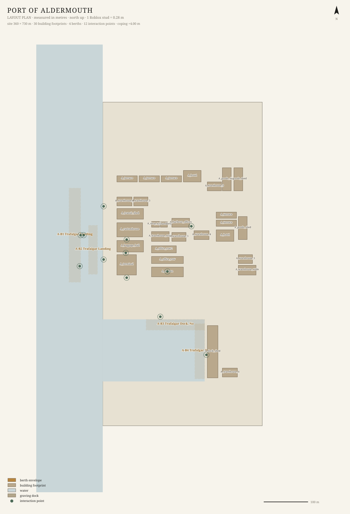

# Port A — The Port of Aldermouth (passenger harbour)

*Generated from `docs/port_a_meta.json` by `tools/gen_layout_docs.py`.*

**Type.** Liverpool-type enclosed, non-tidal passenger dock system

An enclosed dock entered from the river, with the water level held constant by the lock, so that ships berth without waiting on the tide. The passenger terminal, customs, baggage hall and railway station all sit inside the dock estate, and the cargo side of the same port (staithes, transit sheds, dock basin) is visible from the passenger quay.

## 1. Extent

| | |
|---|---|
| Site rectangle | x -30 → 300 m, y -260 → 400 m |
| Site size | 330 × 660 m |
| Site area | 21.8 ha |
| Quay coping | +4 m above water |
| Water | mean level 0.00 m |

## 2. Levels

| Surface | Level (m) |
|---|---|
| Mean water | 0.00 |
| Quay coping | +4 |
| Lock sill | −10.50 |
| Dock bed | −8.00 |
| River bed | −12.00 |
| Landing-stage deck | floating, follows water level |
| Rail head | +4.15 |
| Terminal booking hall floor | +4.20 |

All elevations are relative to mean water, which is fixed: these are enclosed, non-tidal docks, so there is no tide curve to model.

## 3. Berths

The berth rule applied by the layout auditor: a ship of the stated envelope must have **4 m of clear water in total** (2 m either side, 2 m ahead and astern). The liner envelope used throughout is **180 × 20 × 9 m**.

| Berth | Name | Kind | Envelope L×B×draft (m) | Clear water | Length | Depth | Checks |
|---|---|---|---|---|---|---|---|
| A-B1 | Trafalgar Landing Stage, West Face | passenger | 166 × 18 × 6.5 | 18 × 204 m | 204 m | 11 m | CHECK |
| A-B2 | Trafalgar Landing Stage, East Berth (tender/steamer) | passenger | 100 × 14 × 5 | 20 × 110 m | 110 m | 6.5 m | OK |
| A-B3 | Trafalgar Dock, North Quay (cargo) | cargo | 130 × 18 × 8 | 24 × 132 m | 132 m | 9 m | CHECK |
| A-B4 | Trafalgar Dock, East Quay (cargo) | cargo | 116 × 17 × 8 | 22 × 124 m | 124 m | 9 m | OK |

Where a berth reports **CHECK**, the limitation is recorded rather than hidden: see §7.

## 6. Interaction points

Every point below is walked to by a player and is generated into the Roblox layer as a ProximityPrompt anchor. Positions are metres in the Blender frame.

| ID | Point | Kind | Radius | Position (x, y, z) |
|---|---|---|---|---|

## 7. Known limitations

- Berth **B3** is 132 m long against a 130 m envelope: the +4 m end clearance rule is not met at the ends, although it is met abeam. The basin could be lengthened eastward if the dock shed is moved; that change was not made because the shed is a listed-type structure in the composition.
- Berth **B2** is a shallow berth (6.5 m) and takes only the tender/steamer envelope shown; it is not a liner berth, and is not intended to be.
- The **south-east of the site** is laid out as open quay and reserved land rather than built up, so that the dock basin has working room; it reads as the least dense part of the port.
- The landing stage is a **static floating pontoon**: the deck is modelled at mean water level and does not animate with a tide, because these docks are non-tidal.

## 8. Operations the layout supports

A North German Lloyd mail steamer of 1889 turned round in about 29 hours. Coaling was done from barges on the offside: 8 barges of 250–300 t, about 4.5 days for a large mail steamer. Cargo calls ran to 10,000–100,000 packages, worked by 6 gangs of 25 men. The terminal is therefore laid out for overlapping disembarkation and embarkation, with separate baggage and customs routes.

## 9. Circulation

