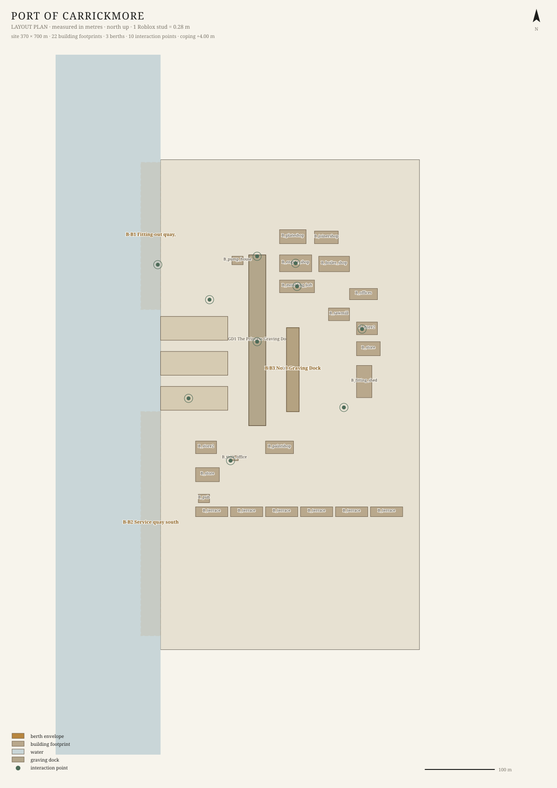

# Port B — The Port of Carrickmore (industrial / shipbuilding harbour)

*Generated from `docs/port_b_meta.json` by `tools/gen_layout_docs.py`.*

**Type.** Belfast-type shipbuilding, repair and fitting-out yard

A shipbuilding and repair estate on the river: three building slips on the frontage, the great Princess Graving Dock behind them, an older small graving dock alongside, and the shops — moulding loft, engineering, boiler, plate and joinery — served by their own rail network inside high brick boundary walls.

## 1. Extent

| | |
|---|---|
| Site rectangle | x -30 → 340 m, y -300 → 400 m |
| Site size | 370 × 700 m |
| Site area | 25.9 ha |
| Quay coping | +4 m above water |
| Water | mean level 0.00 m |

## 2. Levels

| Surface | Level (m) |
|---|---|
| Mean water | 0.00 |
| Quay coping | +4 |
| Graving dock floor (Princess) | −7.00 (coping − 11.00) |
| No. 1 graving dock floor | −4.00 (coping − 8.00) |
| Slip head | +4.00 |
| Slip toe | −6.00, below water |
| River bed | −12.00 |
| Rail head | +4.15 |

All elevations are relative to mean water, which is fixed: these are enclosed, non-tidal docks, so there is no tide curve to model.

## 3. Berths

The berth rule applied by the layout auditor: a ship of the stated envelope must have **4 m of clear water in total** (2 m either side, 2 m ahead and astern). The liner envelope used throughout is **180 × 20 × 9 m**.

| Berth | Name | Kind | Envelope L×B×draft (m) | Clear water | Length | Depth | Checks |
|---|---|---|---|---|---|---|---|
| B-B1 | Fitting-out quay, river frontage (Day Summers 80t sheer legs) | fitting_out | 166 × 18 × 6.5 | 28 × 210 m | 210 m | 10 m | OK |
| B-B2 | Service quay south of the slips | repair | 140 × 18 × 8 | 28 × 320 m | 320 m | 9 m | OK |
| B-B3 | Princess Graving Dock | dry_dock | 166 × 18 × 6.5 | 24.4 × 244 m | 243.8 m | 11 m | OK |

Where a berth reports **CHECK**, the limitation is recorded rather than hidden: see §7.

## 4. Graving docks

| Dock | Built | Plan | Width | Depth on sill | Sections |
|---|---|---|---|---|---|
| The Princess Graving Dock | 1885-1889 | 243.8 × 24.4 m | 24.4 m | 11 m | 3 |
| No. 1 Graving Dock | 1867 | 120 × 18 m | 18 m | 8 m | 1 |

- **The Princess Graving Dock** — Alexandra Graving Dock, Belfast (1885-89)
- **No. 1 Graving Dock** — Hamilton Dock, Belfast (1864-67)

## 5. Building slips

| Slip | Width | Length of ways | Gradient |
|---|---|---|---|
| B-S1 | 34 m | 96 m | 2.6 deg |
| B-S2 | 34 m | 96 m | 2.6 deg |
| B-S3 | 34 m | 96 m | 2.6 deg |

Ocean Steamships (1891)

## 6. Interaction points

Every point below is walked to by a player and is generated into the Roblox layer as a ProximityPrompt anchor. Positions are metres in the Blender frame.

| ID | Point | Kind | Radius | Position (x, y, z) |
|---|---|---|---|---|

## 7. Known limitations

- No **ship under construction** is modelled on the slips. The brief forbids downloaded ship assets and the slips are dressed instead with keel blocks, raking shores, staging and props — the appliances, not a hull.
- The **Princess Dock is pumped dry** and the **No. 1 Dock is flooded** with its caisson seated. Both states are deliberately shown, to demonstrate the caisson arrangement.
- The **96 m ways** cannot launch the 180 m envelope. This is correct: the envelope is handled at the 210 m fitting-out quay, not on the slips.
- The **north-east quadrant** is yard and rail rather than buildings, matching the open materials yards of a working shipyard.

## 8. Operations the layout supports

Fairfield-type yards of the period covered about 74 acres and had up to 15 vessels on the slips at once, at roughly 7,000 t per hull, with sternposts of 26 t. The erecting shops ran around 40 lathes and a 16 ft boring disc. Plate and timber yards fed the shops through the yard rail system; finished hulls were launched stern-first and then completed at the fitting-out quay.

## 9. Circulation

